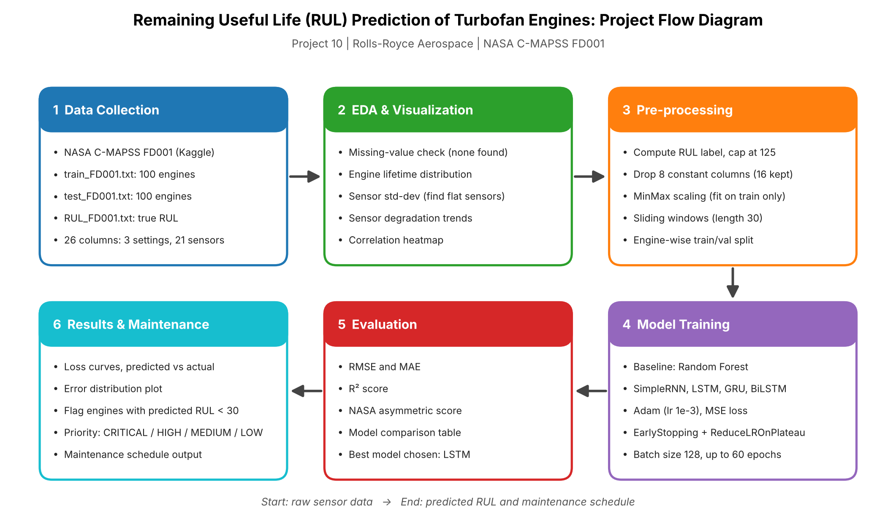
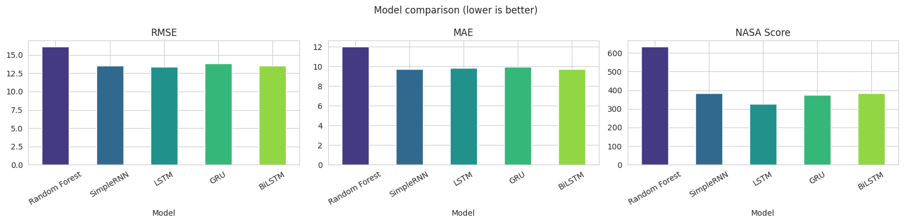
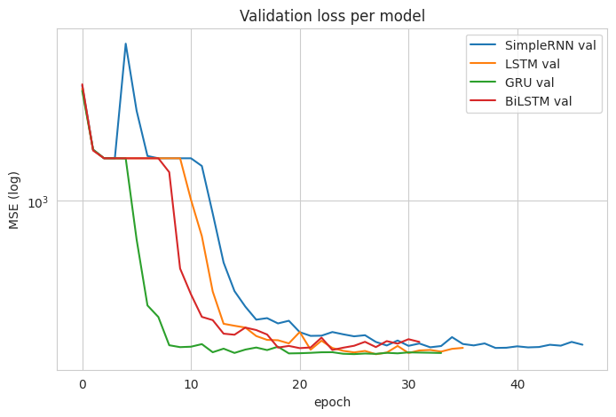
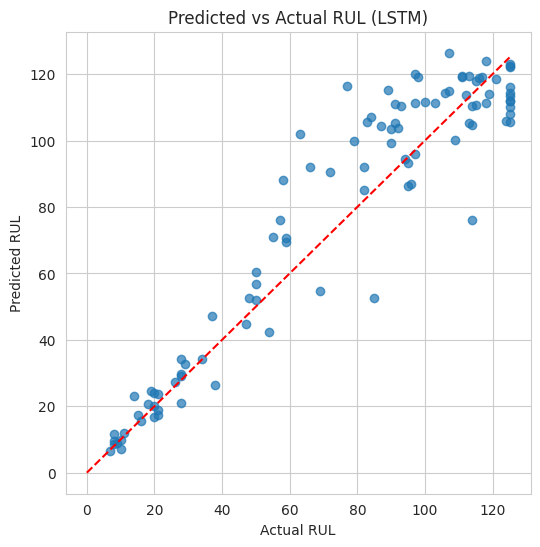
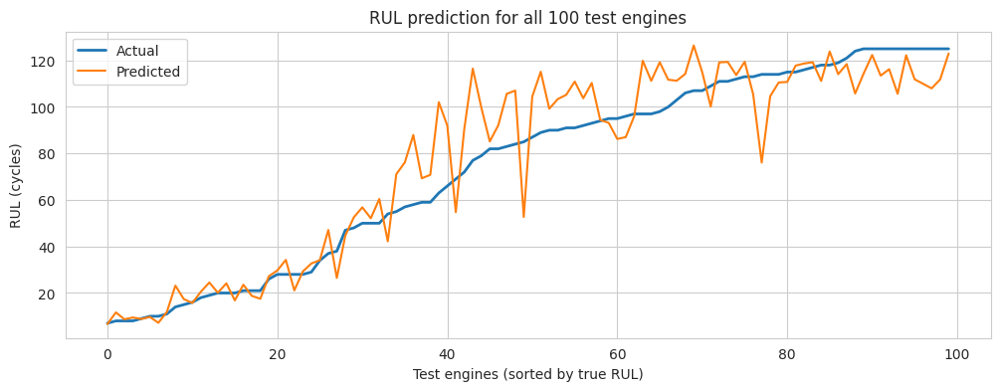
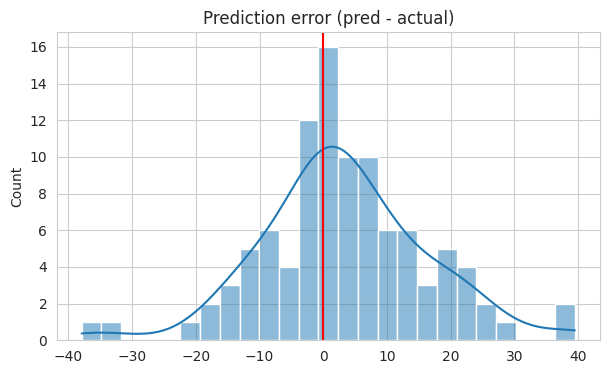
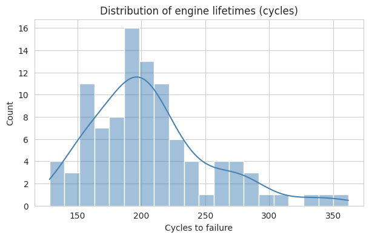
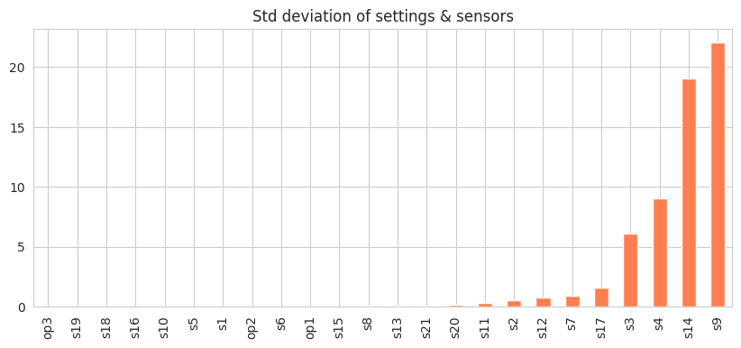
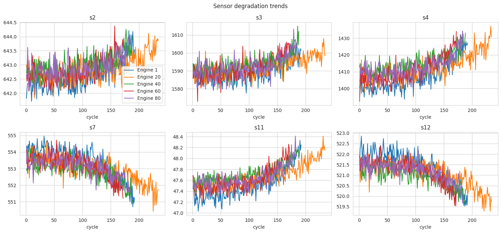
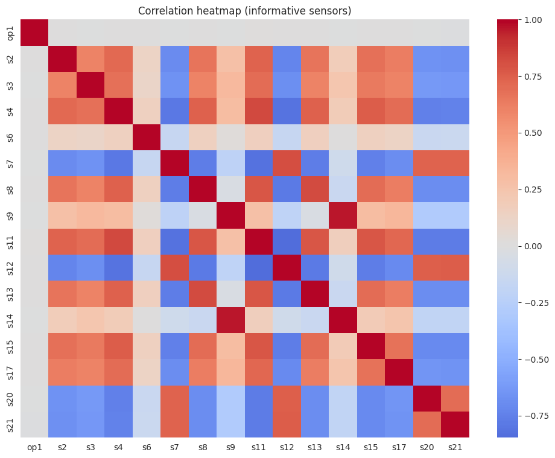

# Remaining Useful Life (RUL) Prediction of Turbofan Engines

**Project 10: Rolls-Royce Aerospace | UCS321 EST Mini Project**
Predictive maintenance using deep learning (SimpleRNN, LSTM, GRU, BiLSTM) on the NASA C-MAPSS dataset.

## Problem Statement
Rolls-Royce Aerospace needs to predict the Remaining Useful Life (RUL) of turbofan engines from multi-sensor time-series data. Accurate predictions let maintenance be scheduled before a failure happens, which reduces unplanned downtime and improves efficiency.

## Dataset
- **NASA C-MAPSS (Turbofan Engine Degradation Simulation), subset FD001**
- 100 training engines (20,631 rows) and 100 test engines (13,096 rows)
- 3 operational settings and 21 sensor readings per cycle, with no missing values
- Training engines run for 128 to 362 cycles before failure (mean about 206)
- Source: https://www.kaggle.com/datasets/behrad3d/nasa-cmaps
- The notebook downloads the dataset automatically with `kagglehub`.

## Workflow



1. **Data loading:** read `train_FD001`, `test_FD001` and `RUL_FD001`
2. **EDA and visualization:** lifetime distribution, sensor standard deviations, sensor degradation trends, correlation heatmap
3. **Pre-processing**
   - Compute the RUL label for each training cycle and **cap it at 125** (piecewise-linear degradation)
   - Drop 8 constant columns (`op2`, `op3`, `s1`, `s5`, `s10`, `s16`, `s18`, `s19`), leaving **16 features**
   - Scale features with **MinMaxScaler** (fit on training data only)
   - Build **sliding windows** of 30 cycles (window length = 30)
   - **Engine-wise split** (15 validation engines) to avoid data leakage
   - Test set: last 30-cycle window of each test engine
   - Shapes: Train (15104, 30, 16), Val (2627, 30, 16), Test (100, 30, 16)
4. **Model building**
   - Baseline: Random Forest (100 trees, on flattened windows)
   - Deep models: SimpleRNN, LSTM, GRU, BiLSTM (two recurrent layers with 64 and 32 units, Dropout 0.2, Dense 32, output Dense 1)
   - Adam (lr = 1e-3), MSE loss, batch size 128, up to 60 epochs, EarlyStopping (patience 8) and ReduceLROnPlateau
5. **Evaluation:** RMSE, MAE, R² and the NASA asymmetric scoring function
6. **Visualization:** model comparison, validation loss curves, predicted vs actual RUL, error distribution
7. **Maintenance scheduling logic:** predicted RUL is turned into maintenance priorities

## Model Code

All models use the same pre-processed data: 30-cycle windows, MinMax scaling, RUL capped at 125 and an engine-wise train/validation split. Test data is the last 30-cycle window of each of the 100 test engines.

### 1. Random Forest (baseline)

Each window is flattened into one feature vector, so the temporal order is ignored.

```python
rf = RandomForestRegressor(n_estimators=100, n_jobs=-1, random_state=SEED)
rf.fit(X_tr.reshape(len(X_tr), -1), y_tr)
p = rf.predict(X_te.reshape(len(X_te), -1))
```

### 2. Shared setup for the neural networks

```python
def build(kind):
    m = models.Sequential([layers.Input((SEQ, len(features)))])
    # ... recurrent layers for each model (see below) ...
    m.add(layers.Dropout(0.2))
    m.add(layers.Dense(32, activation='relu'))
    m.add(layers.Dense(1))
    m.compile(optimizer=tf.keras.optimizers.Adam(1e-3), loss='mse', metrics=['mae'])
    return m

es = callbacks.EarlyStopping(monitor='val_loss', patience=8, restore_best_weights=True)
rl = callbacks.ReduceLROnPlateau(monitor='val_loss', factor=0.5, patience=4)
m.fit(X_tr, y_tr, validation_data=(X_val, y_val),
      epochs=60, batch_size=128, callbacks=[es, rl], verbose=0)
```

### 3. SimpleRNN

```python
m.add(layers.SimpleRNN(64, return_sequences=True))
m.add(layers.Dropout(0.2))
m.add(layers.SimpleRNN(32))
```

### 4. LSTM (best model)

```python
m.add(layers.LSTM(64, return_sequences=True))
m.add(layers.Dropout(0.2))
m.add(layers.LSTM(32))
```

### 5. GRU

```python
m.add(layers.GRU(64, return_sequences=True))
m.add(layers.Dropout(0.2))
m.add(layers.GRU(32))
```

### 6. Bidirectional LSTM

```python
m.add(layers.Bidirectional(layers.LSTM(64, return_sequences=True)))
m.add(layers.Dropout(0.2))
m.add(layers.LSTM(32))
```

### 7. NASA scoring function

```python
def nasa_score(y, p):
    d = p - y
    return float(np.sum(np.where(d < 0, np.exp(-d/13) - 1, np.exp(d/10) - 1)))
```

The full runnable code is in `RUL_Turbofan_CMAPSS.ipynb`.

## Results (FD001 test set, 100 engines)

| Model | RMSE | MAE | R² | NASA Score |
|---|---|---|---|---|
| Random Forest (baseline) | 16.142 | 12.036 | 0.838 | 634.205 |
| SimpleRNN | 13.561 | 9.746 | 0.885 | 382.411 |
| **LSTM** | **13.353** | 9.859 | **0.889** | **324.896** |
| GRU | 13.815 | 9.979 | 0.881 | 374.394 |
| BiLSTM | 13.495 | **9.731** | 0.887 | 383.615 |

*Lower RMSE, MAE and NASA score are better. Higher R² is better.*

**Best model: LSTM**, with the lowest RMSE and NASA score and the highest R². Compared with the Random Forest baseline, it cut RMSE from 16.14 to 13.35 (about 17% lower) and the NASA score from 634 to 325 (about 49% lower). The four deep models perform close to each other, and BiLSTM has a slightly lower MAE.







## Maintenance Scheduling
Engines are flagged for maintenance when predicted RUL is below 30 cycles. With the LSTM model, **24 of 100 engines** were flagged.

| | Precision | Recall | F1 |
|---|---|---|---|
| OK | 0.97 | 0.99 | 0.98 |
| Maintain | 0.96 | 0.92 | 0.94 |

Overall accuracy was 0.97: 23 of 25 at-risk engines were caught, with 1 false alarm and 2 missed.

Predicted RUL is also converted into priority levels:

| Priority | Predicted RUL (cycles) | Engines |
|---|---|---|
| CRITICAL | 0 to 15 | 8 |
| HIGH | 15 to 30 | 16 |
| MEDIUM | 30 to 60 | 11 |
| LOW | above 60 | 65 |

## Exploratory Data Analysis





## Key Findings
- Sequence models (SimpleRNN, LSTM, GRU, BiLSTM) beat the Random Forest baseline because they learn temporal degradation patterns.
- Capping RUL at 125 and dropping constant sensors improves training stability.
- The LSTM gave the best overall accuracy and the lowest NASA score, which penalizes late predictions more heavily.
- Predicted RUL converts into a maintenance schedule that catches 92% of engines that are close to failure.

## How to Run
1. Open `RUL_Turbofan_CMAPSS.ipynb` in Google Colab and set the runtime to GPU (T4).
2. Run all cells (Runtime -> Run all). Training the four neural networks takes roughly 10 to 20 minutes.

Or locally:
```bash
pip install -r requirements.txt
jupyter notebook RUL_Turbofan_CMAPSS.ipynb
```

## Tech Stack
Python, TensorFlow/Keras, scikit-learn, pandas, NumPy, Matplotlib, Seaborn, kagglehub

## Future Work
- Other subsets (FD002 to FD004) with multiple operating conditions
- Attention layers and Transformers
- Deployment as a dashboard

## Acknowledgement
Dataset: NASA Prognostics Center of Excellence, C-MAPSS turbofan engine degradation simulation.
