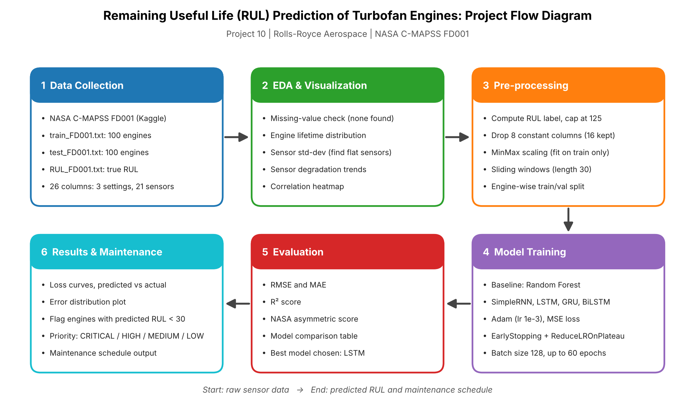

# Remaining Useful Life (RUL) Prediction of Turbofan Engines

UCS321 EST Mini Project, Project 10 (Rolls-Royce Aerospace).

Predicts the Remaining Useful Life of turbofan engines from multi-sensor time-series data (NASA C-MAPSS, FD001) so maintenance can be scheduled proactively.

## Models
Random Forest (baseline), SimpleRNN, LSTM, GRU, Bidirectional LSTM

## Pipeline

Load data, EDA, pre-processing (RUL cap 125, drop constant sensors, MinMax scaling, 30-cycle sliding windows, engine-wise split), training, evaluation (RMSE, MAE, R2, NASA score), visualization, maintenance scheduling.

## How to run
1. Open `RUL_Turbofan_CMAPSS.ipynb` in Google Colab.
2. Runtime > Run all. The dataset downloads automatically from Kaggle, or upload `train_FD001.txt`, `test_FD001.txt`, `RUL_FD001.txt` when prompted.

## Dataset
NASA C-MAPSS Turbofan Engine Degradation Simulation Data Set (Kaggle: behrad3d/nasa-cmaps).
